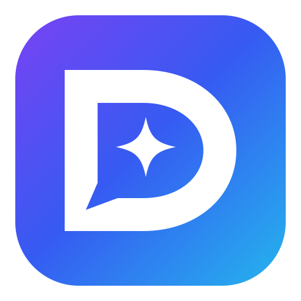
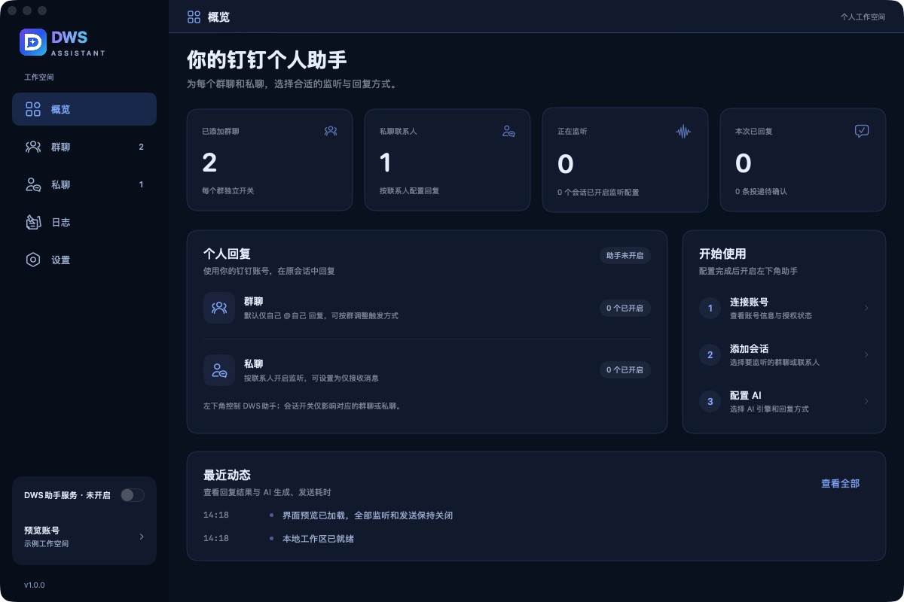

<p align="center">
  
</p>

<h1 align="center">DWS Assistant</h1>

<p align="center">在 macOS 上管理你的 DWS助手。</p>

<p align="center"><strong>简体中文</strong> · <a href="README_EN.md">English</a></p>

<p align="center"><a href="#安装">安装与构建</a> · <a href="docs/CONFIGURATION.md">配置说明</a> · <a href="https://github.com/StarRain/DWS-Assistant/issues">问题反馈</a></p>

<p align="center">
  
  
  
  <a href="LICENSE"></a>
</p>

DWS Assistant（DWS助手）是一个原生 macOS 应用，通过 [DingTalk Workspace CLI（DWS）](https://github.com/DingTalk-Real-AI/dingtalk-workspace-cli) 连接钉钉，使用本机 AI 引擎处理消息，并以你的账号在原会话中回复。应用提供主面板、菜单栏和独立快捷面板。

> 当前版本仅使用一个已登录的钉钉账号，支持群聊和私聊。登录成功后，由你手动开启 DWS助手服务。

## 界面预览



截图来自预览模式，账号、会话和统计均为模拟数据。

## 核心能力

### 会话与监听

- 按群名或联系人姓名搜索，选择结果后配置并添加，无需手动填写 ID。
- 每个群聊和私聊独立控制监听与自动回复。
- 群聊默认「仅自己 @自己 回复」，也可选择「仅 @自己 回复」或「收到消息自动回复」。
- 过滤助手自身回复，合并重复事件；停止服务或关闭会话监听时取消对应任务。
- 自动检测授权变化；通过面板或 DWS 命令退出登录后，停止助手并返回登录页。

### AI 回复与交互

- 支持 **Codex、Claude Code、Qoder、Gemini**，使用用户已安装并登录的 CLI。
- 每个会话独立选择引擎、模型、思考强度与执行权限；支持从引擎读取可用选项。
- 支持普通文本、Markdown 和 AI 卡片。卡片先显示处理状态，再更新同一卡片的结果。
- 交互卡片支持确认、取消、单选、多选和文字输入，默认等待 **60 秒**，可配置超时。
- Codex 卡片可展示实际命令、工具等执行进度；原消息可用表情反馈处理、完成或失败。
- 支持当前消息及同会话引用消息中的图片，识别能力取决于所选模型。

### 规则与上下文

- 自定义当前会话的回复要求或任务步骤，规则条数不限，每条内容最多 2,000 字。
- 独立弹窗编写规则，列表中可开启、编辑、删除；支持从其他会话选择规则并克隆为独立副本。
- 每个钉钉群聊或私聊固定对应一个 Codex 会话；修改模型或强度会在下一轮生效。
- 可自定义 Codex 会话名称，留空时使用群名或联系人名。
- 授权目录默认留空，可添加多个目录；目录与执行权限分别配置。

### macOS 体验

- 支持简体中文与 English，默认简体中文；可在「设置 → 界面语言」或登录页立即切换。
- 支持浅色、深色与跟随系统，界面使用统一矢量图标。
- 菜单栏和快捷面板可控制助手、查看统计与最近动态。
- 关闭主窗口后隐藏程序坞图标，保留菜单栏及正在运行的服务。
- 可设置登录 macOS 时启动；应用启动不会自动开启监听。

界面语言不会更改账号和会话名称、自定义规则、引擎设置、AI 回复语言或磁盘上的原始日志。DWS 与 AI 引擎的原始输出保留其自身语言。

## 工作方式

```text
钉钉群聊 / 私聊
  → DWS 官方事件订阅
  → 会话配置、触发判断与回复去重
  → 本机 AI 引擎（Codex / Claude Code / Qoder / Gemini）
  → DWS 以当前账号回复原会话
```

DWS 负责授权、消息收发和表情操作。DWS助手管理会话配置与任务状态，复用固定版本 DWS 的本地 AI 适配器；Gemini 使用本机 CLI 适配。面板不会移动工具的安装目录，也不会修改引擎的全局配置。

## 安装

### 环境要求

- macOS 14 或更高版本，当前构建已在 Apple Silicon 上验证。
- 已安装 [DWS CLI](https://github.com/DingTalk-Real-AI/dingtalk-workspace-cli#installation)。
- 自动回复需要至少一个已安装并登录的 AI 引擎：Codex、Claude Code、Qoder 或 Gemini。
- 从源码构建需要 Swift 6、Xcode 命令行工具、Go 1.26.7 或更新版本，以及 Python 3。

### 从源码构建

当前提供源码构建方式：

```sh
git clone https://github.com/StarRain/DWS-Assistant.git
cd DWS-Assistant
bash scripts/build-app.sh
```

首次构建会下载并校验固定版本的 DWS 源码及依赖。Go 默认从 `PATH` 或 `.build/toolchain/go/bin/go` 查找，也可通过 `DWS_ASSISTANT_GO` 指定路径。

构建产物为 `dist/DWS Assistant.app`，可复制到“应用程序”文件夹后打开。构建脚本会打包 AI 适配 helper、图标、语言资源和许可证，并执行 ad hoc 签名；当前未进行 Apple 公证。

## 使用

1. 打开应用，在前置页检查 DWS 安装状态，点击「去登录」完成钉钉官方授权。
2. 进入「群聊」或「私聊」，点击「添加群聊」或「添加联系人」，搜索并选择会话。
3. 开启会话监听与自动回复，选择触发方式、回复形式和 AI 引擎。需要读取项目时，再添加授权目录。
4. 如需约定回复风格或任务步骤，在「AI 回复设置 → 自定义规则」中添加规则，完成后保存会话配置。
5. 打开左下角「DWS助手服务」。关闭主窗口可继续通过菜单栏使用；「关闭助手并退出」会停止服务。

群聊触发方式：

| 选项 | 何时回复 |
| --- | --- |
| 仅自己 @自己 回复（默认） | 当前登录账号本人发出真实的自我 @ 消息 |
| 仅 @自己 回复 | 他人或本人 @当前登录账号 |
| 收到消息自动回复 | 收到他人消息，或本人手动 @自己 |

助手发出的回复不会再次触发。已有会话保留原先保存的触发方式；私聊按联系人独立开启自动回复。

| 快捷键 | 功能 |
| --- | --- |
| `⇧⌘D` | 打开快捷面板 |
| `⌘Q` | 关闭助手并退出 |

完整行为与配置细节见 [配置与行为说明](docs/CONFIGURATION.md)。

### 设置与规则的优先级

消息先经过面板的程序判断，符合条件才调用 AI；引擎随后按配置运行，并理解适用的自定义规则。**面板的程序控制和引擎实际权限优先于自定义规则。**

| 层级 | 包含内容 | 冲突时的行为 |
| --- | --- | --- |
| 面板程序控制 | 监听开关、回复触发方式、发送对象、回复形式、超时 | 由程序决定，文字规则不能覆盖 |
| 引擎配置与权限 | 模型、思考强度、执行权限及目录参数 | 通过引擎参数或接口设置，规则不能提高实际权限 |
| 文字提示 | 自定义规则、默认语言与回复风格、任务步骤 | 由 AI 理解；规则与默认文字提示、或多条规则之间，目前没有统一的冲突检测与固定裁决顺序 |

例如，面板选择「仅 @自己 回复」，规则写“只能回复自己 @自己的消息”：他人 @当前账号时仍会进入 AI 处理流程，不能依赖这条文字规则实现严格的身份限制。应直接将面板改为「仅自己 @自己 回复」，在调用 AI 前过滤他人的消息。

规则中的“执行打包脚本”也不会自动获得写入权限。请在面板中配置所需目录和执行权限，并避免保存互相矛盾的文字规则。

## 数据与权限

- 应用名称为 DWS Assistant（DWS助手），Bundle ID 为 `com.starrain.dwsassistant`；更名后继续沿用已有数据目录。
- 面板数据保存在 `~/.dws-dashboard`，包括配置、状态日志、投递记录与引擎会话映射。
- DWS 和 AI 引擎沿用各自的登录状态；面板不迁移它们的凭据。
- 授权目录默认为空，添加目录不会自动提高执行权限。目录列表不构成完整的文件读取沙箱，实际访问范围由引擎权限决定。
- 普通消息正文不写入活动日志；AI 卡片投递记录会保存卡片内容和交互定义。AI 引擎自身也可能保留会话历史。
- 图片仅临时缓存：总量最多 64 MiB，单张最多 8 MiB，每条消息最多 4 张，处理结束后清理。
- 发送结果不确定时保留记录供排查，不自动重发；交互卡片过期后不执行任务。

## 开发与验证

```sh
# Swift 核心与应用测试
bash scripts/swift.sh test

# 官方适配层测试
bash scripts/build-bridge.sh --test

# 构建应用
bash scripts/build-app.sh
```

独立预览使用模拟账号与会话，不启动真实监听或 AI 任务：

```sh
open -n "dist/DWS Assistant.app" --args --preview --data-dir /tmp/dws-assistant-preview
```

```text
Sources/DashboardCore       配置、命令、事件路由与持久化
Sources/DWSAssistant        SwiftUI 界面与任务协调
Integrations/DWSBridge      DWS 官方 AI 适配器包装与测试
Tests                      Swift 回归测试
Assets                     品牌与界面矢量素材
scripts                    构建、图标生成与许可证收集
```

测试使用临时目录与模拟 CLI，覆盖消息路由、防循环、会话恢复、配置变更、图片缓存、交互卡片和语言切换。自动化测试不向真实钉钉会话发送消息。

## 相关项目

- [DingTalk Workspace CLI](https://github.com/DingTalk-Real-AI/dingtalk-workspace-cli)：钉钉官方 CLI，本项目使用其消息能力与本地 AI 适配器。
- [Codex Account Manager](https://github.com/StarRain/Codex-Account-Manager)：同作者的原生 macOS Codex 账号管理工具。

## 参与贡献

欢迎通过 [Issues](https://github.com/StarRain/DWS-Assistant/issues) 反馈问题或建议，也可提交 Pull Request。

问题反馈请附上 macOS 版本、DWS 与 AI 引擎版本、复现步骤和脱敏日志。提交前运行与改动相关的测试；Git 提交标题使用 `type(scope): summary`，例如 `fix(cards): 修复取消后的卡片状态`。

## 开源协议

项目代码采用 [Apache License 2.0](LICENSE)，版权与第三方组件说明见 [NOTICE](NOTICE) 和 [THIRD_PARTY_NOTICES.md](THIRD_PARTY_NOTICES.md)。

界面图标参考素材的原始下载未附作者与许可信息，这些第三方素材不因本项目协议而获得额外授权；复用素材前需另行确认许可。

## 说明

DWS Assistant 是独立社区项目，并非钉钉官方产品。DingTalk、Codex、Claude、Qoder、Gemini 等名称和商标归各自权利人所有。
