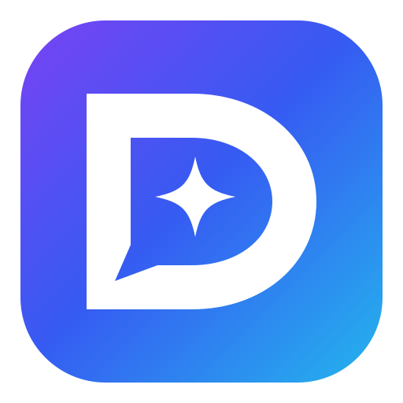
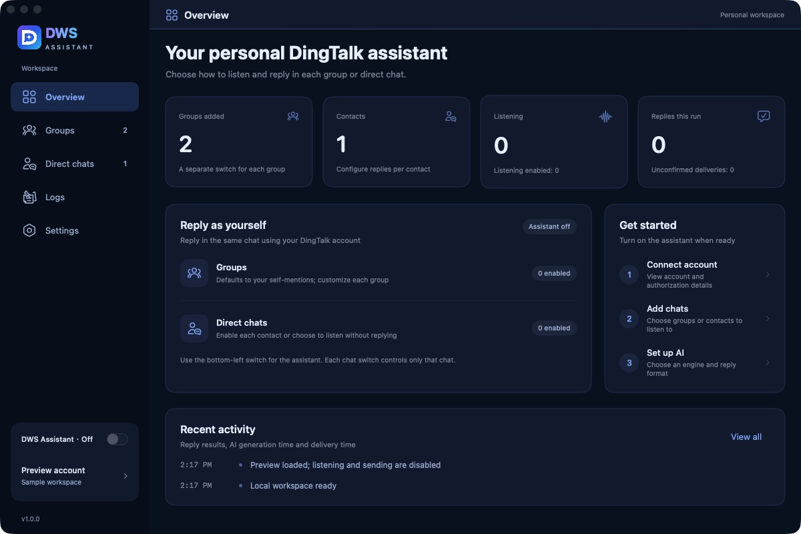

<p align="center">
  
</p>

<h1 align="center">DWS Assistant</h1>

<p align="center">Manage your DWS Assistant on macOS.</p>

<p align="center"><a href="README.md">简体中文</a> · <strong>English</strong></p>

<p align="center"><a href="#installation">Build and install</a> · <a href="#usage">Usage</a> · <a href="https://github.com/StarRain/DWS-Assistant/issues">Report an issue</a></p>

<p align="center">
  
  
  
  <a href="LICENSE"></a>
</p>

DWS Assistant is a native macOS app that connects to DingTalk through [DingTalk Workspace CLI (DWS)](https://github.com/DingTalk-Real-AI/dingtalk-workspace-cli). It uses locally installed AI engines to process messages and reply in the original chat using your account. The app includes a dashboard, a menu bar panel, and a standalone quick panel.

> This version supports one signed-in DingTalk account, with group and direct chats. You turn on the assistant manually after signing in.

## Preview



Captured in preview mode. Account details, chats and statistics are sample data.

## Features

### Chats and listening

- Search by group or contact name, select a result, then configure and add it. No manual ID entry is needed.
- Control listening and automatic replies separately for each group or contact.
- Groups default to **Only when you mention yourself**. You can also reply when anyone mentions you, or to incoming messages.
- Filters assistant replies and deduplicates events. Stopping the assistant or disabling listening cancels the corresponding tasks.
- Detects authorization changes. Signing out through the dashboard or DWS CLI stops the assistant and returns to the sign-in page.

### AI replies and interactive cards

- Supports **Codex, Claude Code, Qoder and Gemini**, using CLIs you have already installed and signed in to.
- Set the engine, model, reasoning level and execution permissions for each chat. Available options can be read from the engine.
- Reply with plain text, Markdown or AI cards. Cards show processing status first, then update the same card with the result.
- Interactive cards support confirmation, cancellation, single and multiple choices, and text input. The default response timeout is **60 seconds** and can be changed.
- Codex cards can show actual command and tool progress. Reactions on the original message can indicate processing, completion or failure.
- Supports images in the current message and quoted messages from the same chat, subject to the selected model's capabilities.

### Rules and context

- Define reply guidelines or task steps for each chat. There is no limit on the number of rules; each rule supports up to 2,000 characters.
- Add and edit rules in a separate dialog. Enable, edit or delete them from the list, or clone selected rules from another chat as independent copies.
- Each DingTalk group or direct chat maps to its own Codex chat in `~/.dws-dashboard/codex/`. Model and reasoning changes apply on the next turn of the same chat.
- Open **History** on a Codex chat row to read messages, replies and execution records, refresh them or load earlier records. Viewing history does not start an AI task.
- Customize the Codex chat name, or leave it blank to use the group or contact name.
- Authorized directories are empty by default. You can add multiple directories and configure execution permissions separately.

### macOS experience

- English and Simplified Chinese interfaces, defaulting to **Simplified Chinese**. Switch instantly in **Settings → Interface language**, or use the language selector on the sign-in page.
- Light, dark and system appearance, with consistent vector icons.
- Control the assistant and view statistics and recent activity from the menu bar or quick panel.
- Closing the main window hides the Dock icon while keeping the menu bar and running services available.
- Quitting stops listeners and active tasks, then exits after cleanup. If stopping is incomplete, the app stays open so you can retry.
- Optional launch at macOS login. Launching the app does not automatically start listening.

Interface language does not change chat names, custom rules, engine settings, AI reply language or the original logs stored on disk. Raw output from DWS and AI engines remains in its original language.

## How it works

```text
DingTalk group / direct chat
  → Official DWS event subscription
  → Chat settings, trigger checks and reply deduplication
  → Local AI engine (Codex / Claude Code / Qoder / Gemini)
  → DWS replies to the original chat using the current account
```

DWS handles authorization, messages and reactions. DWS Assistant manages chat settings and task state, reusing the local AI adapters from a pinned DWS version. Gemini uses a local CLI adapter. The app does not move your installed tools or change their global configuration.

## Installation

### Requirements

- macOS 14 or later. The current build has been verified on Apple Silicon.
- [DWS CLI](https://github.com/DingTalk-Real-AI/dingtalk-workspace-cli#installation) installed.
- At least one installed and signed-in AI engine for automatic replies: Codex, Claude Code, Qoder or Gemini.
- Building from source requires Swift 6, Xcode command line tools, Go 1.26.7 or later, and Python 3.

### Build from source

The current distribution method is a source build:

```sh
git clone https://github.com/StarRain/DWS-Assistant.git
cd DWS-Assistant
bash scripts/build-app.sh
```

The first build downloads and verifies the pinned DWS source and dependencies. Go is discovered through `PATH` or `.build/toolchain/go/bin/go`; set `DWS_ASSISTANT_GO` to use a specific executable.

The output is `dist/DWS Assistant.app`. Copy it to Applications and open it. The build script bundles the AI adapter helper, icons, language resources and licenses, then applies an ad hoc signature. The app is currently not notarized by Apple.

## Usage

1. Open the app and check DWS installation on the setup page. Click **Sign in** to complete the official DingTalk authorization flow.
2. Open **Groups** or **Direct chats**, click **Add group** or **Add contact**, then search and select a chat.
3. Enable listening and automatic replies. Choose a trigger, reply format and AI engine. Add authorized directories when the AI needs to read a project.
4. To define reply style or task steps, open **AI reply settings → Custom rules**. Save the chat settings after editing rules.
5. Turn on **DWS Assistant** at the bottom left. You can close the main window and keep using the menu bar. **Stop assistant and quit** stops the services, waits for cleanup, then exits.

Group reply triggers:

| Option | When it replies |
| --- | --- |
| Only when you mention yourself (default) | The signed-in account manually sends a real self-mention |
| When anyone mentions you | Another person or you mention the signed-in account |
| Reply to incoming messages | A message arrives from someone else, or you manually mention yourself |

Assistant replies never trigger another reply. Existing chats keep their saved trigger. Automatic replies for direct chats are enabled per contact.

| Shortcut | Action |
| --- | --- |
| `⇧⌘D` | Open the quick panel |
| `⌘Q` | Stop the assistant and quit |

Additional implementation and behavior details are available in the [configuration guide (Chinese)](docs/CONFIGURATION.md).

### Codex chats and history

Each group or direct chat has its own Codex context. Changes to the model, reasoning level, authorized directories, execution permissions, rules or chat name apply on the next turn without creating a new chat.

Click **History** in the chat list to view user messages, AI replies and execution records for the currently bound chat, including expandable command details. The panel only reads this app's saved records. It does not start the AI, acquire the chat's writer lock, or display internal instructions or reasoning records.

After switching to dedicated storage, the first reply creates a new Codex chat without adopting or migrating old history. Existing desktop Codex records remain intact. New DingTalk chats do not appear in the recent chats of desktop Codex using its default storage. If this app's native chat record has been deleted, a replacement is created only after Codex confirms the record is missing and before task execution starts; the log reports the lost context.

### Settings and rule priority

Messages pass the dashboard's programmatic checks before the AI is called. The engine then runs with its configured settings and interprets applicable custom rules. **Programmatic controls and actual engine permissions take precedence over custom rules.**

| Layer | Includes | Conflict behavior |
| --- | --- | --- |
| Dashboard controls | Listening switch, reply trigger, recipient, reply format, timeouts | Enforced by code; text rules cannot override them |
| Engine configuration and permissions | Model, reasoning level, execution permissions and directory parameters | Applied through engine arguments or APIs; rules cannot elevate actual permissions |
| Text instructions | Custom rules, default language and reply style, task steps | Interpreted by the AI; there is currently no universal conflict checker or fixed resolution order between custom rules and default text instructions, or between multiple rules |

For example, if the dashboard is set to **When anyone mentions you**, a rule saying “only reply when I mention myself” does not prevent another person's mention from entering the AI processing flow. Do not rely on a text rule for strict identity filtering. Select **Only when you mention yourself** in the dashboard to filter before calling the AI.

Likewise, a rule saying “run the build script” does not grant write access. Configure the necessary directories and execution permissions in the dashboard, and avoid contradictory rules.

## Data and permissions

- The app is named DWS Assistant, with Bundle ID `com.starrain.dwsassistant`. The rename keeps the existing data directory.
- Dashboard data lives in `~/.dws-dashboard`, including configuration, activity logs, delivery records and engine chat mappings.
- Codex message content, execution records, databases, runtime logs and writer locks live in `~/.dws-dashboard/codex/`, separate from authorized project directories and desktop Codex history.
- DWS and AI engines keep their own sign-in state. The app does not migrate their credentials.
- The dedicated Codex directory links to existing configuration, sign-in files, rules, skills and other inputs. It does not copy old chats or share desktop databases or writer locks.
- Authorized directories are empty by default. Adding a directory does not elevate execution permissions. The directory list is not a complete file-reading sandbox; actual access depends on the engine's permissions.
- Ordinary message bodies are not written to activity logs. AI card delivery records include card content and interaction definitions. Native Codex chat records include message and reply content; other AI engines may also retain their own chat history.
- Images are cached temporarily: up to 64 MiB total, 8 MiB per image and 4 images per message, cleared after processing.
- Unconfirmed deliveries are retained for investigation and are not automatically resent. Expired interactive cards cannot execute tasks.

## Development and verification

```sh
# Swift core and application tests
bash scripts/swift.sh test

# Official adapter tests
bash scripts/build-bridge.sh --test

# Build the app
bash scripts/build-app.sh
```

An isolated preview uses sample accounts and chats, without real listeners or AI tasks:

```sh
open -n "dist/DWS Assistant.app" --args --preview --data-dir /tmp/dws-assistant-preview
```

```text
Sources/DashboardCore       Configuration, commands, event routing and persistence
Sources/DWSAssistant        SwiftUI interface, localization and task coordination
Integrations/DWSBridge      Official DWS AI adapter wrapper and tests
Tests                      Swift regression tests
Assets                     Brand and vector UI assets
scripts                    Build, icon generation and license collection
```

Tests use temporary directories and mocked CLIs. They cover routing, reply loop prevention, chat recovery and storage isolation, read-only history, configuration changes, image caching, interactive cards, language switching and cleanup before quitting. Automated tests do not send messages to real DingTalk chats.

## Related projects

- [DingTalk Workspace CLI](https://github.com/DingTalk-Real-AI/dingtalk-workspace-cli): the official DingTalk CLI; this project uses its messaging capabilities and local AI adapters.
- [Codex Account Manager](https://github.com/StarRain/Codex-Account-Manager): a native macOS Codex account manager by the same author.

## Contributing

Report bugs or suggestions through [Issues](https://github.com/StarRain/DWS-Assistant/issues), or submit a pull request.

Include your macOS version, DWS and AI engine versions, reproduction steps and redacted logs. Run tests relevant to your change before submitting. Commit titles use `type(scope): summary`, for example `fix(cards): update card state after cancellation`.

## License

Project code is licensed under the [Apache License 2.0](LICENSE). See [NOTICE](NOTICE) and [THIRD_PARTY_NOTICES.md](THIRD_PARTY_NOTICES.md) for copyright and third-party component details.

The original UI icon reference download did not include author or license information. This project's license does not grant additional rights to those third-party assets; verify their license before reusing them.

## About this project

DWS Assistant is an independent community project, not an official DingTalk product. DingTalk, Codex, Claude, Qoder, Gemini and other names and trademarks belong to their respective owners.
